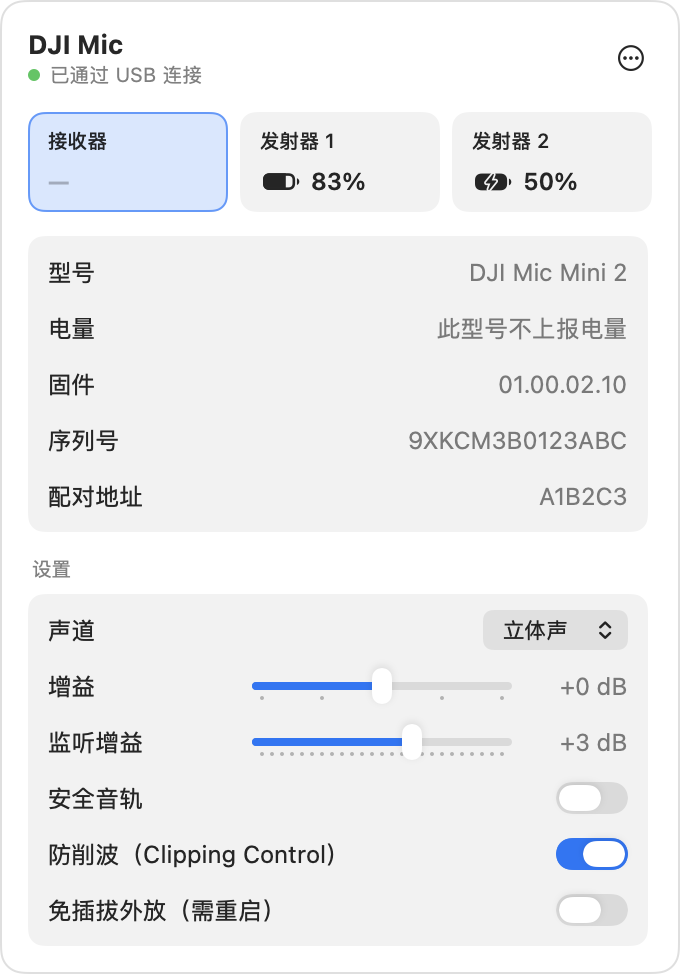
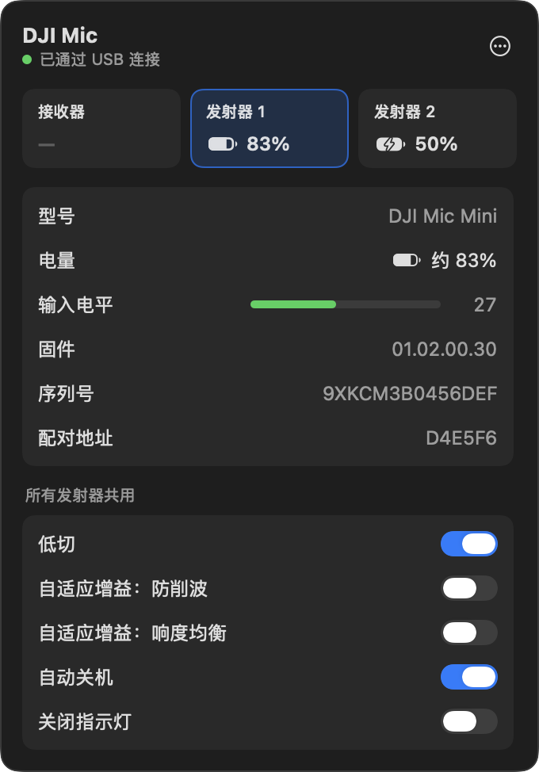
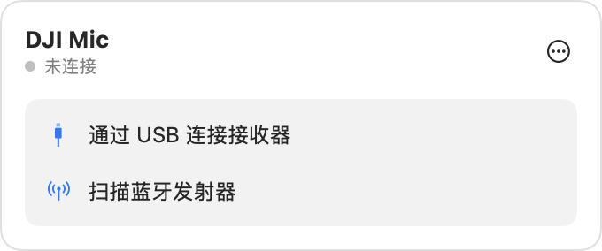

# DJIMicTray

在 macOS 菜单栏里查看和控制 DJI Mic Mini 系列，不用掏手机开 DJI Mimo。

<p align="center">
  
  
</p>

<sub>截图使用示例数据。</sub>

## 能做什么

- **一眼看到电量**。顶部每台设备一张卡片，显示电量和充电状态，正在内录的设备带红点。
- **查看设备参数**。型号、固件版本、序列号、配对地址、实时输入电平、内录时长。
- **修改设置**。声道、增益、安全音轨、降噪、低切、自适应增益、音色、32-bit 浮点录音、自动录音、
  循环录音、振动、指示灯、自动关机等。界面只列出当前机型支持的项，改动立即写入设备。
- **两种连接方式**。
  - USB：插上接收器自动连接，同时管理接收器和所有已配对的发射器。
  - 蓝牙：扫描并直连单个发射器，不需要接收器。
- 内录时菜单栏图标变成录音标记；可以设为登录时启动。

## 支持的设备

| 设备 | USB | 蓝牙 |
| --- | --- | --- |
| DJI Mic Mini / Mini 2 / Mini 2S 接收器 | ✓ | — |
| DJI Mic 系列手机接收器（Mobile Receiver） | ✓ | — |
| DJI Mic Mini / Mini 2 / Mini 2S 发射器 | 经接收器 | ✓ |

实机验证过的组合是 DJI Mic Mini 2 接收器加 DJI Mic Mini 发射器，走 USB。其余机型和蓝牙直连按上游协议实现，
还没有在真机上测过。

## 安装

需要 macOS 14 及以上和 Xcode 命令行工具。

```sh
git clone https://github.com/qqqqqf-q/DJIMicTray.git
cd DJIMicTray
./build.sh
open build/DJIMicTray.app
```

`build.sh` 产出的 app 是本地 ad-hoc 签名，只适合在自己的机器上用。首次扫描蓝牙时系统会请求蓝牙权限。

## 使用

1. 把接收器用 USB 插到 Mac 上，菜单栏的麦克风图标会变成实心，表示已连接。
2. 点图标打开面板，点顶部的设备卡片切换要看的设备。
3. 发射器页面里“所有发射器共用”一组的设置（降噪、低切等）会同时作用于全部发射器。
4. 右上角的 ⋯ 菜单里有登录时启动、插入时自动连接、复制状态 JSON、断开和退出。

<p align="center">
  
</p>

## 已知限制

- **电量是约数**。设备只上报 7 个档位，界面上的百分比按档位折算。DJI Mic Mini 2 接收器不上报自身电量。
- **不能和上游网页版同时用**。接收器的控制接口同一时间只能被一个程序打开，Chrome 里开着网页版时这里会连接失败，反过来也一样。
- 输入电平的满刻度和内录时长的单位，上游都没有说明。电平条按本次见过的最大值定量程，内录时长原样显示数值。
- 同时插入多个接收器时不会自动选择，需要只保留一个。
- 协议来自上游的抓包逆向，适用的固件版本以上游 README 为准。

## 实现

协议移植自 [usokawa/dji-mic-mo](https://github.com/usokawa/dji-mic-mo)（基线 commit `7c2dd5b`），用 Swift 原生实现：
USB 走 IOUSBHost，在用户态直接打开接收器的厂商接口，不影响它作为声卡工作；蓝牙走 CoreBluetooth。
不依赖 Python、libusb 或浏览器。界面是 SwiftUI，挂在 NSStatusItem 的弹出面板里。

“复制状态 JSON”导出的结构和上游 CLI 相同，方便对照排查。发射器格式化在上游网页版是一键执行，这里加了二次确认。

## 许可

协议实现源自 dji-mic-mo，Copyright (c) 2026 usokawa_，按 BSD 2-Clause 许可再分发，
许可全文见 `LICENSE-dji-mic-mo.md`，打包时会一并放进 app 的 Resources 目录。
